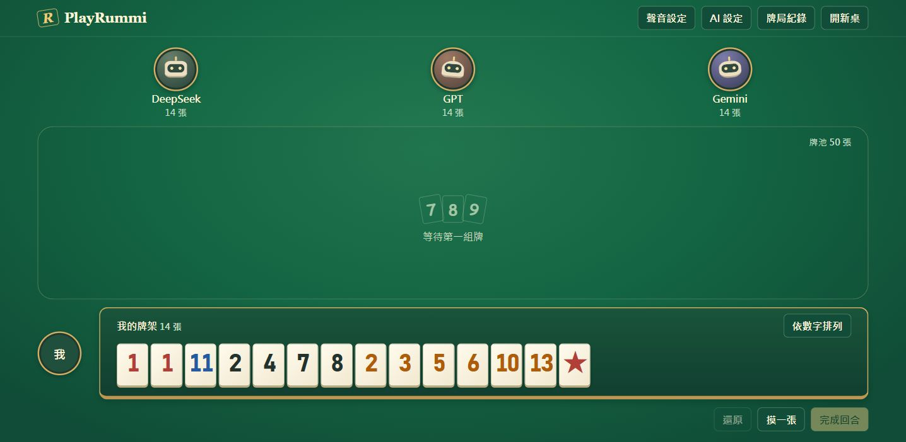

# PlayRummi

PlayRummi 是一款繁體中文拉密牌桌。你可以在本機與 1–3 位練習對手同桌，免 API 金鑰，也可以選用 OpenAI、Gemini 或 DeepSeek 當牌友。

## 快速開始

1. 確認已安裝 Node.js 22.20 以上。專案使用 Node.js 內建的 SQLite，免執行 `npm install`。
2. 在專案目錄執行 `npm start`。
3. 用瀏覽器開啟 <http://127.0.0.1:4173>，在「開新桌」選 1–3 位「本機練習」對手，再按「洗牌開局」。

每次完成回合會自動存到 `data/game.sqlite`，重新整理或重啟服務後可繼續遊玩。未送出的試排只保留在目前頁面。「洗牌開局」會取代現有存檔。

## API 對手（選用）

點「AI 設定」或開桌視窗中的「設定 AI 金鑰與模型」。選供應商、輸入 API 金鑰、選模型（也可輸入自訂模型 ID），按「儲存設定」。每家分別儲存，下次 API 呼叫立即生效。修改模型時，金鑰留白即可沿用。開桌時從席位選單選取已設定的對手。

網頁設定存在本機 `data/settings.sqlite`，其中含明文金鑰，請勿分享該檔案。網頁只顯示金鑰是否已設定。既有 `.env` 或環境變數仍可作為預設值。API 回合會使用該帳戶的額度。斷線或回傳非法出牌時，保留原回合，可按「重試回合」。

## 牌桌操作與採用規則

- 每人起手 14 張。拖一張牌到桌面空白處可建立牌組；點選多張後，拖動任一張已選牌即會按點選順序整組移動。拖到牌張的左半或右半可插在它前面或後面，拖回牌架可重新排列。同色連號按小到大排，或以三至四種不同顏色組同數牌。首次只能使用手牌，總點數至少 30。
- 完成破冰後，之後的回合可以拆組重排。可選取桌牌移回待排區，再依所需順序重新分組。提交時須保留全部原桌牌，並新增至少一張手牌。
- 百搭牌以星號顯示，可代表任一張，採自由重排玩法。
- 牌桌允許先試排，虛線標出尚未成組的牌列。「還原」撤回本回合全部調整。摸牌立即結束回合。
- 出清手牌即獲勝。牌池空時可過牌，全桌連續過牌後依剩餘手牌點數決勝，百搭計 30 分，同分並列。

## 驗證

`npm test` 執行規則、整局與 API 模擬測試。
